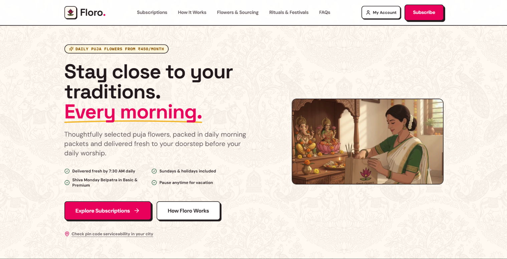
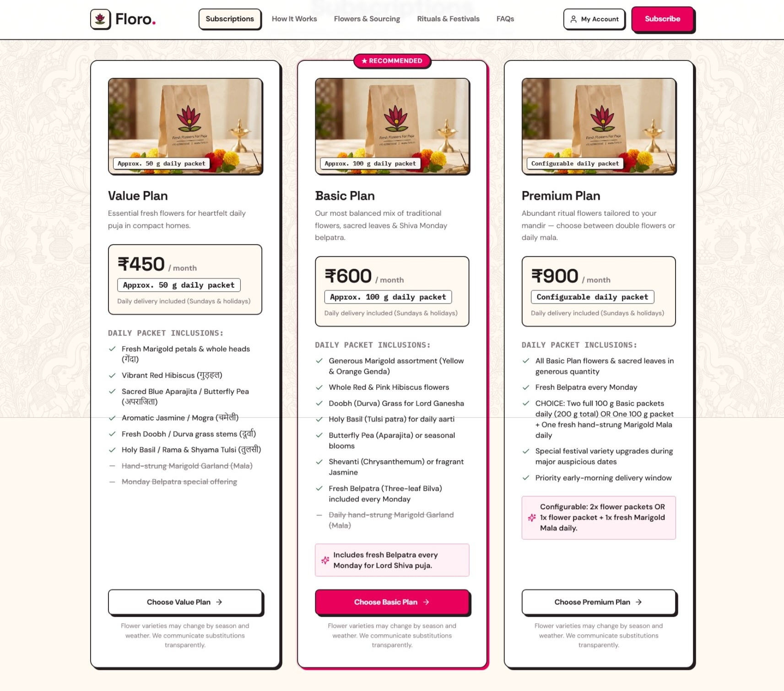
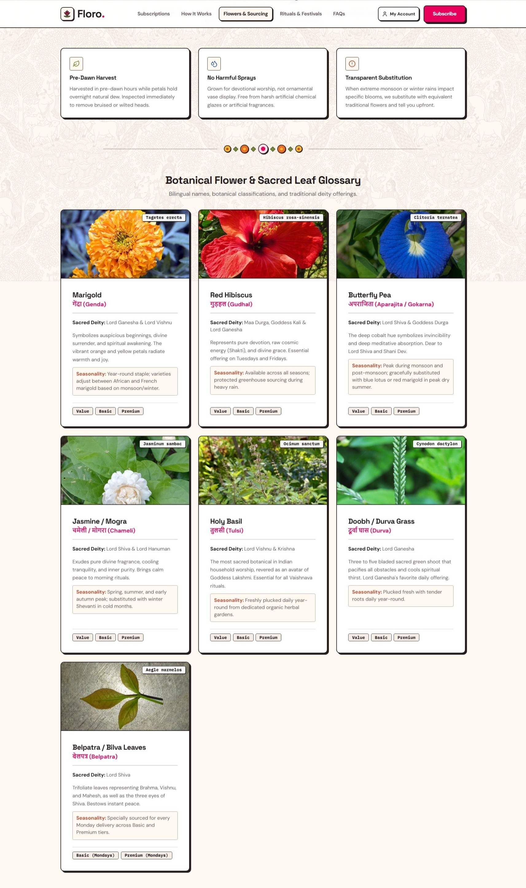
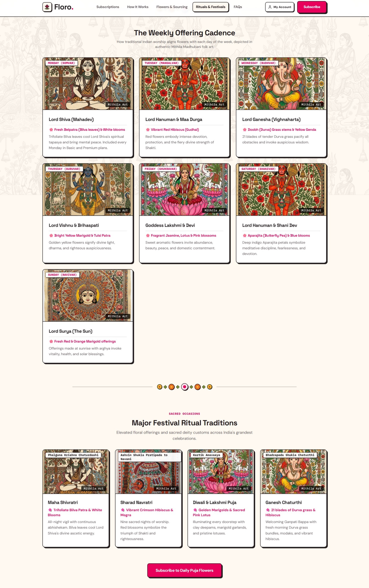
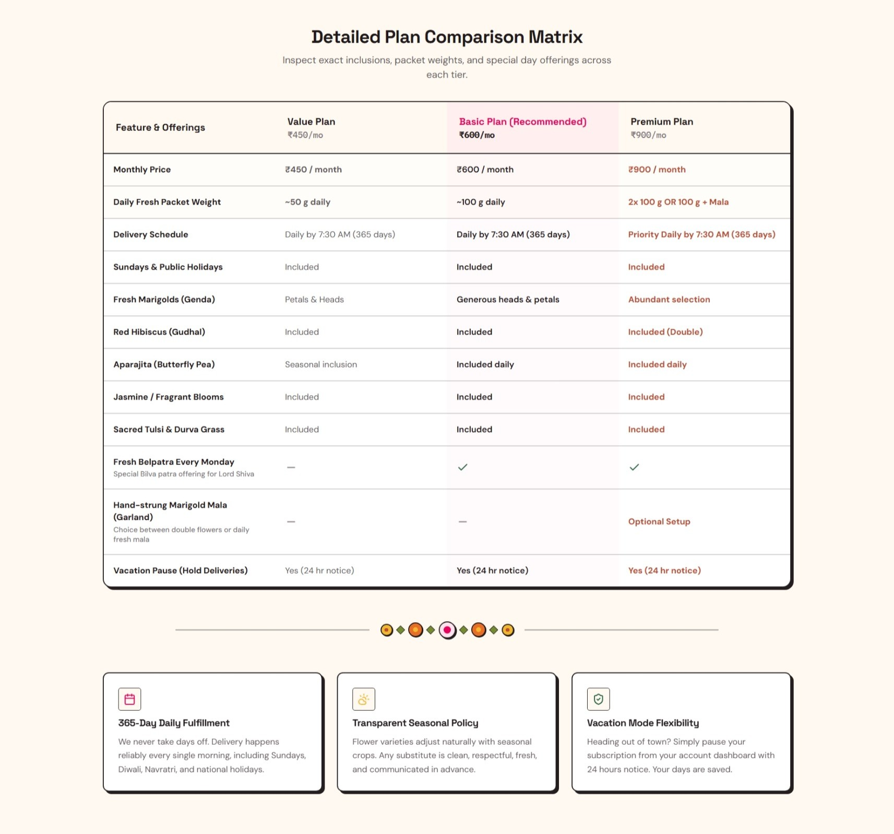

# Floro — Independent Product & UX Redesign

### Exploring a more ritual-aware daily flower subscription experience

An independent redesign concept exploring how cultural context, clearer subscription choices, and transparent service expectations could shape the customer experience for a daily puja-flower subscription.

- **Project type:** Independent product and UX exploration
- **Role:** Product Manager
- **Tech stack:** Next.js 14 (App Router), TypeScript, Tailwind CSS
- **Status:** Interactive front-end prototype; payment processing and production integrations are not implemented.

> **Disclaimer:** This project uses [Floro.in](https://floro.in/) as a public reference point (observed October 2026). It is an independent design study, not affiliated with or endorsed by Floro, and the proposed experience does not represent its actual commercial terms or service commitments.

---

## 1. Project Background & Intent

Daily worship (*puja*) is an essential morning anchor in millions of Indian households. However, sourcing fresh, unblemished flowers every morning before work often means rushed trips to informal local markets or relying on unpredictable neighborhood vendors.

Floro is a subscription service concept designed to deliver fresh puja flowers directly to doorsteps every morning. Using the public [Floro.in](https://floro.in/) experience as an operational reference point, this redesign explores how the digital customer journey could address three specific design opportunities:

1. **Cultural Relevance:** Ground the digital experience in traditional devotional context through folk-art-inspired visual language, sacred botanical knowledge, and ritual guidance.
2. **Clarity Before Commitment:** Help prospective subscribers compare daily portion sizes, flower mixes, and delivery conditions clearly before entering a subscription.
3. **Trust Through Transparency:** Communicate sourcing practices, early-morning delivery hours (before 7:30 AM), and seasonal flower substitution rules clearly upfront.

---

## 2. Research & Content Attribution

To ensure analytical rigor and transparency, this case study clearly distinguishes between verified observations, illustrative design assumptions, and proposed operational requirements:

| Information Category | Presentation in Redesign | Source / Operational Context |
|---|---|---|
| **Reference Website Details** | Public observations from [Floro.in](https://floro.in/) | Observed during initial research (October 2026). |
| **Plan Pricing & Inclusions** | Illustrative product assumptions | The ₹450, ₹600, and ₹900 monthly tiers mirror reference price points; daily packet weights (~50g, ~100g, ~200g/Mala) and specific flower inclusions are proposed design modeling. |
| **Delivery & Sourcing Standards** | Proposed operating requirements | Morning delivery windows (by 7:30 AM), Monday Belpatra inclusions, and weather substitution policies represent design hypotheses that require operational validation. |
| **Customer Testimonials** | Illustrative placeholders | Labeled explicitly as concept examples; not implied as genuine customer testimonials. |
| **Ritual & Botanical Guidance** | Traditional cultural reference | Scriptural associations and flower recommendations cited from traditional Hindu customs, acknowledging regional and domestic ritual variance. |
| **Art & Visual Craft** | Digital folk-art-inspired illustrations | Digital illustrations created in the visual tradition of Mithila (Madhubani) linework and Kalamkari patterns, rather than physical hand-painted artworks. |

---

## 3. Prioritisation and Scope

I separated the core subscription journey from features that enrich the broader experience.

### Core Journey
- **Understand and compare subscription options:** Help users distinguish between tiers, portions, and inclusions quickly.
- **Check serviceability early:** Allow users to verify whether delivery is supported at their PIN code before committing time.
- **Understand delivery expectations:** Clarify morning drop-off hours, holiday fulfillment, and substitution rules.

### Supporting Experience
- **Explore sacred botanicals and deity traditions:** Dedicated guides covering flower significance, weekday deities, and respectful *nirmalya* disposal.
- **Conceptual account management:** A preview of subscriber self-service controls, including a delivery hold/pause calendar and address book.

### Excluded from Prototype
- Live payment gateway integration (PCI-compliant processing).
- Production SMS gateway and server-backed authentication.
- Real-time inventory and delivery-fleet tracking.

*This scope keeps the central subscription journey visible while allowing the wider experience to be explored without implying that operational systems already exist.*

---

## 4. Key Visual Moments

The redesign communicates product decisions through four focused visual moments:

### Visual Moment 1: Homepage & Cultural Identity


- **What decision does this demonstrate?** Pairs Madhubani-inspired devotional visual craft (Lord Surya on chariot) with high-contrast Neo-Brutalist typography (`Space Grotesk` / `DM Sans`), warm ivory tones (`#FFF9F1`), and prominent primary actions (*Explore Subscriptions* and *Check PIN Code*).
- **Why it matters to the user?** Evokes the sanctity of morning worship immediately while ensuring that visitors can immediately understand the product offering and check delivery availability without navigational friction.

---

### Visual Moment 2: Subscription Comparison & Portion Clarity


- **What decision does this demonstrate?** Organizes the three tiers (Value at ₹450/mo, Basic at ₹600/mo, Premium at ₹900/mo) with explicit daily packet weights (~50g, ~100g, ~200g/Mala) and highlighted weekly inclusions (such as Monday Belpatra for Lord Shiva).
- **Why it matters to the user?** Eliminates the common ambiguity where subscribers cannot tell whether listed gram weights represent a daily delivery or a monthly aggregate, allowing them to choose a plan suited to their mandir size with confidence.

---

### Visual Moment 3: Cultural & Botanical Depth




- **What decision does this demonstrate?** Introduces dedicated bilingual botanical cards with Devanagari script (*बिल्वपत्र*, *दूर्वा*, *तुलसी*, *अपराजिता*), traditional deity associations, and respectful *nirmalya* (spent flower) composting guidance.
- **Why it matters to the user?** Transforms the product from an anonymous flower delivery utility into a respectful morning ritual companion, reassuring devotees that flowers are treated with ritual reverence from harvest to disposal.

---

### Visual Moment 4: Operational Transparency & Subscriber Journey


- **What decision does this demonstrate?** Maps out the subscriber journey through a transparent 4-step flow: dawn farm sourcing, daily doorstep delivery by 7:30 AM, holiday continuity (365 days), and flexible pause controls.
- **Why it matters to the user?** Directly addresses the top operational questions customers ask before subscribing: "Will flowers arrive in time for my morning puja?" and "Can I pause deliveries when traveling?"

> 📖 **Extended Inventory:** For the complete 7-day weekday deity illustration gallery, botanical photography catalog, and exhaustive route breakdown, see [`docs/artwork-and-cultural-inventory.md`](docs/artwork-and-cultural-inventory.md).

---

## 5. Design Decisions & Trade-offs

### 5.1 Cultural Reverence vs. Interface Usability
- **The Tension:** Elaborate folk ornamentation can easily clutter an interface, distract from pricing, or slow down comprehension.
- **The Resolution:** Confined traditional folk motifs to purposeful narrative illustrations, divider bands (`<FolkGarlandDivider />`), and subtle background textures. Core interactive elements (buttons, form inputs, tier cards) retain crisp 2px borders, tactile offsets, and clean whitespace.

### 5.2 Educational Content vs. Conversion Efficiency
- **The Tension:** Deep ritual, scriptural, and botanical information placed directly into the checkout funnel could cause decision fatigue.
- **The Resolution:** Maintained a streamlined, conversion-focused primary path on the homepage and subscriptions page, while housing deeper editorial and cultural content in dedicated secondary routes (`/flowers-and-sourcing`, `/rituals-and-festivals`).

### 5.3 Stated Service Promises vs. Logistics Feasibility
- **The Tension:** Stating firm morning delivery cutoffs (7:30 AM) and specific leaf varieties creates strict operational expectations.
- **The Resolution:** Clearly framed all operational standards, substitution rules, and delivery commitments as proposed operating models, highlighting where physical logistics alignment is required.

---

## 6. Technical Implementation & Prototype Boundaries

This repository is an interactive front-end prototype built to explore UX and design principles. It explicitly outlines its technical architecture and boundaries below:

| Functional Area | Prototype Implementation | Production Requirement |
|---|---|---|
| **Subscription Catalog** | Next.js 14 App Router; displays 3 plans, interactive Premium toggle, and matrix table. | Dynamic product catalog backed by inventory database and regional pricing rules. |
| **Checkout Flow** | Illustrative 5-step guided walkthrough with explicit "Demo Mode" disclaimer. | PCI-compliant payment gateway integration (e.g. Razorpay/Stripe) with server-side validation. |
| **Authentication & OTP** | Simulated local OTP verification (`123456`) stored in browser memory. | Authoritative auth provider with live SMS gateway (e.g. Twilio Verify, Supabase Auth). |
| **PIN Serviceability** | Client-side lookup checking sample hub PINs (`110001`, `560034`, `400050`, `800001`) with waitlist capture in `localStorage`. | Live logistics partner API with dynamic hub geofencing and delivery-slot calculation. |
| **Account Management** | Interactive UI demonstrating calendar date toggles (pause/skip) and address saving. | Production database storing active subscriptions, recurring webhooks, and billing records. |
| **Accessibility Intent** | Implemented high-contrast color pairs (`#241D20` on `#FFF9F1`), minimum 14px body text, keyboard navigation outlines, and semantic landmarks. | Formal automated accessibility auditing (e.g. Axe-core) and screen-reader testing prior to certification claims. |
| **Responsive Behavior** | Implemented responsive flex/grid layouts collapsing desktop matrix tables into touch-friendly stacked cards on mobile viewports. | Cross-browser device testing across varied viewport sizes and Android/iOS browsers. |

---

## 7. How I Would Validate the Design

Before considering this direction ready for commercial deployment, I would test these design hypotheses with representative users:

### Hypothesis-Test-Evidence Matrix

| Hypothesis | Test Method | Evidence to Collect |
|---|---|---|
| **Plan differences are easy to understand** | Moderated task: ask participants to review the plans and choose one for their household, explaining their reasoning aloud. | Correct understanding of daily packet weights (~50g vs ~100g), Monday Belpatra inclusion, and price tiers. |
| **Availability can be established early** | Usability task: ask participants to verify delivery availability for both a supported and an unsupported PIN code. | Task completion rate, time to find the checker, and points of hesitation. |
| **Cultural content adds value without distraction** | Comparative task: observe whether participants engage with botanical guides and deity calendars, and measure cognitive load. | Discoverability, perceived relevance, reading depth, and checkout drop-off rate. |
| **Mobile interactions are ergonomic** | Unmoderated usability test on mobile viewports (390px–428px) navigating plan selection and calendar pause controls. | Tap accuracy, absence of mis-taps, scannability of stacked plan cards. |

*Note: Measurable success thresholds (e.g., >85% comprehension on first visit) should be established prior to testing. No claims of superior conversion or user satisfaction are made without empirical study data.*

---

## 8. Running the Prototype Locally

### Prerequisites
- Node.js 18.17 or higher
- npm, pnpm, or yarn

### Quickstart

```bash
# 1. Clone the repository
git clone https://github.com/chiraggoyal001/redisigning-floro.git
cd redisigning-floro

# 2. Install dependencies
npm install

# 3. Start the local development server
npm run dev
```

Open [http://localhost:3000](http://localhost:3000) in your browser to explore the interactive prototype.

### Key Routes
- `/` — Redesigned Homepage with Surya Madhubani art, trust pillars, and serviceability trigger
- `/subscriptions` — 3 Plan cards, Premium configuration toggle, and side-by-side comparison matrix
- `/how-it-works` — 4-step subscriber journey, morning timeline (harvest to 7:30 AM delivery), and basket care
- `/flowers-and-sourcing` — Botanical glossary of sacred flowers/leaves with Devanagari script and Nirmalya guide
- `/rituals-and-festivals` — "7 Days of Devotion" weekday deity guide with folk-art illustrations
- `/checkout` — Illustrative 5-step guided checkout flow (demo mode)
- `/confirmation` — Order receipt screen with delivery schedule
- `/account` — Conceptual subscriber dashboard with vacation pause/skip calendar
- `/faq` & `/contact` — Categorized FAQ accordion and support hub

---

> Crafted as an independent design exploration of culture, clarity, and trust in modern digital ritual services.
