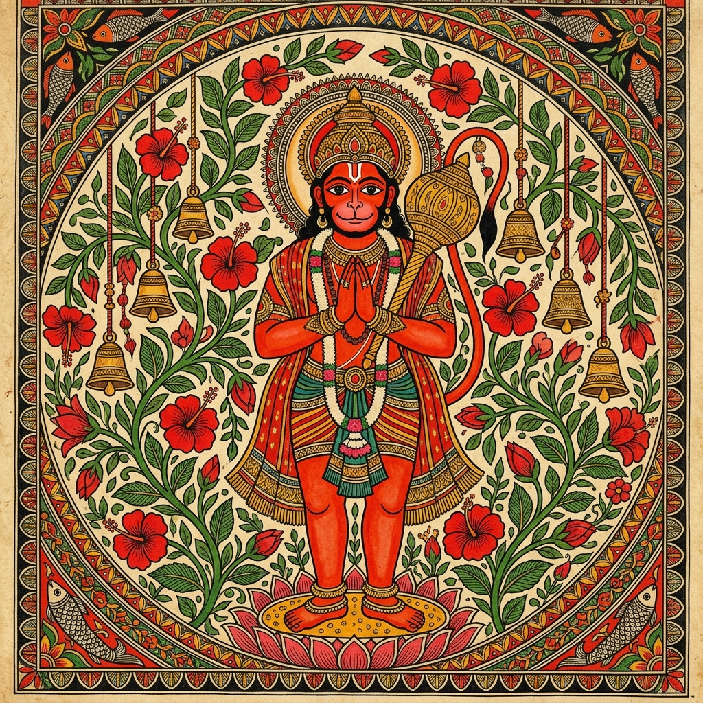
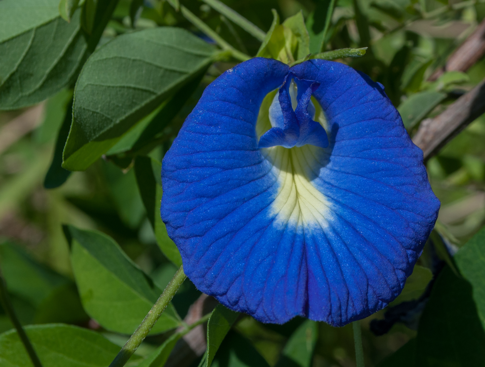

# Floro Redesign — Artwork & Cultural Inventory

> **Supporting Document:** Comprehensive reference for visual assets, devotional art motifs, botanical photography, and route architectures created for the Floro redesign exploration.  
> **Main Case Study:** See [`README.md`](../README.md) for the executive summary, product decisions, and validation plan.

---

## 1. Visual Craft & Art Direction

### 1.1 Folk Art Traditions in Modern UI
The visual language of this redesign draws inspiration from two distinct classical Indian folk-art styles:

1. **Mithila (Madhubani) Painting:** Known for geometrical line work, two-dimensional framing, fish/peacock/floral borders, and depictions of sacred narratives and deities. Used for primary narrative illustrations and weekday devotional calendars.
2. **Kalamkari Motifs:** Known for organic botanical vines, tree-of-life motifs, and muted earth-toned line work. Used as a subtle SVG background wallpaper (`#FFF9F1` canvas) to lend texture without compromising contrast.

> **Provenance Note:** Illustrations in this prototype are digital assets styled in the tradition of Madhubani and Kalamkari art forms, rather than commissioned physical hand-painted folk artworks.

---

## 2. 7 Days of Devotion — Deity Artwork Gallery

In Hindu worship, each day of the week is traditionally associated with a specific planetary ruler (*graha*) and presiding deity. Devotees often align morning offerings, colors, and flowers with these customs.

### 2.1 Weekday Deity Illustrations

| Weekday | Presiding Deity | Traditional Offering | Madhubani-Inspired Visual |
|---|---|---|:---:|
| **Sunday (Ravivar)** | **Lord Surya** (The Sun God) | Red Hibiscus, Lotus, red & golden marigolds |  |
| **Monday (Somvar)** | **Lord Shiva** (Mahadeva) | Sacred Bilva Patra (three-blade leaves), white flowers, raw milk |  |
| **Tuesday (Mangalvar)** | **Lord Hanuman** / Mangal | Sindoor-colored blooms, orange marigolds, jasmine oil |  |
| **Wednesday (Budhvar)** | **Lord Ganesha** | Fresh Durva / Doobh grass (21 blades), red hibiscus |  |
| **Thursday (Guruvar)** | **Lord Vishnu** & Brihaspati | Yellow marigolds, pitambari blooms, sacred Tulsi leaves |  |
| **Friday (Shukravar)** | **Goddess Lakshmi** & Shukra | Pink lotus, fragrant Mogra/Jasmine, red rose petals |  |
| **Saturday (Shanivar)** | **Lord Shani** & Hanuman | Indigo Aparajita blooms, blue flowers, Shami leaves |  |
| **Festivals** | **Maa Durga** (Navratri) | 9-day sacred varieties, fresh garlands, red hibiscus |  |

*Cultural Context Note: Worship practices vary widely across Indian regions, lineages, and domestic traditions. These associations represent widespread pan-Indian customs cited in traditional texts.*

---

## 3. Sacred Botanical Varieties & Photography

Puja flowers are sacred offerings (*pushpam*), held to strict ritual standards of cleanliness, freshness, and unbruised purity.

### 3.1 Botanical Varieties Catalog

| Traditional Name | Scriptural / Botanical Context | Recommended Offerings | High-Resolution Specimen |
|---|---|---|:---:|
| **Bilva Patra (बिल्वपत्र)** *Aegle marmelos* | Three-blade trifoliate sacred leaves representing the trident of Lord Shiva, creation, preservation, and dissolution. | Lord Shiva (Somvar puja, Pradosham, Mahashivratri). Never offered broken. |  |
| **Durva Grass (दूर्वा)** *Cynodon dactylon* | Sacred 3- or 5-blade grass shoots symbolizing rejuvenation and coolness. | Lord Ganesha (21 shoots tied together). Untouched by chemical fertilizers. |  |
| **Holy Basil / Tulsi (तुलसी)** *Ocimum tenuiflorum* | The most sacred household botanical in Vaishnava traditions; Rama & Shyama varieties. | Lord Vishnu, Krishna, Rama. Strictly avoided in Lord Ganesha offerings. |  |
| **Aparajita (अपराजिता)** *Clitoria ternatea* | Deep indigo-blue butterfly pea flower symbolizing purity and divine mystery. | Lord Shiva, Goddess Durga, and Lord Shani. Highly valued on Saturdays. |  |

### 3.2 Nirmalya Management (Spent Flower Care)
In daily Hindu practice, flowers offered to deities become *nirmalya* (sacred remains) and must not be discarded into ordinary domestic garbage.

The prototype incorporates an educational Nirmalya guide proposing:
1. **Home Mandir Compost:** Drying or composting spent flowers separately for domestic garden soil.
2. **Scheduled Nirmalya Collection:** An exploratory operational concept where morning delivery partners collect dried spent flowers in returnable compost pouches for community garden composting or sacred incense recycling.

---

## 4. Exhaustive Route & Screen Directory

The interactive front-end prototype implements the following routes:

| Route Path | Primary Purpose | Key Features & Modules |
|---|---|---|
| `/` | **Landing & Homepage** | Hero visual with Madhubani Surya illustration, trust pillars, plan highlights, Folk Garland accent dividers, serviceability modal trigger, and FAQ previews. |
| `/subscriptions` | **Plan Selection & Matrix** | 3 Plan cards (Value, Basic, Premium), configurable Premium toggle (Double volume vs. Daily Garland), and full side-by-side feature comparison matrix. |
| `/how-it-works` | **Subscriber Journey** | 4-step onboarding timeline, dawn harvest-to-door schedule (4:30 AM – 7:30 AM), door basket care instructions, and subscription pause rules. |
| `/flowers-and-sourcing` | **Botanical & Sourcing Guide** | Bilingual glossary of 7 sacred flowers and leaves with Devanagari script, ethical grower standards, and respectful Nirmalya care. |
| `/rituals-and-festivals` | **Devotional Calendar** | "7 Days of Devotion" weekday deity guide, festival calendars (Navratri, Diwali, Shivratri), and scriptural offering rules. |
| `/checkout` | **Illustrative Checkout Flow** | 5-step guided flow: Plan Summary, Simulated OTP verification, Address Book, Delivery Preferences, and Demo Payment. |
| `/confirmation` | **Order Receipt Screen** | Visual confirmation, simulated order ID, first delivery date, and links to account dashboard. |
| `/account` | **Customer Self-Service Hub** | Conceptual dashboard featuring vacation pause calendar, active subscription management, delivery address editor, and past invoices. |
| `/faq` | **Frequently Asked Questions** | 14 categorized accordion questions covering flower care, delivery hours, holiday fulfillment, and substitutions. |
| `/contact` | **Support & Inquiries** | Multi-channel contact hub with customer support hours, email, and WhatsApp links. |

---

## 5. Design System & Component Library

| Component Name | File Location | Rationale & Functionality |
|---|---|---|
| `<FolkGarlandDivider />` | `src/components/common/FolkGarlandDivider.tsx` | Cultural accent band inspired by traditional marigold and mango leaf torans, used as a subtle section divider. |
| `<ServiceabilityModal />` | `src/components/common/ServiceabilityModal.tsx` | On-demand modal dialog allowing prospective subscribers to check delivery availability by PIN code with waitlist capture. |
| `<NeoButton />` | `src/components/common/NeoButton.tsx` | Accessible interactive button with bold 2px border, tactile shadow offset, and clear focus states. |
| `<NeoCard />` | `src/components/common/NeoCard.tsx` | High-contrast card container supporting clean grouping of prices, botanical descriptions, and calendar days. |
| `<Header />` & `<Footer />` | `src/components/layout/` | Responsive navigation with mobile menu drawer, serviceability links, and cultural trust commitments. |
