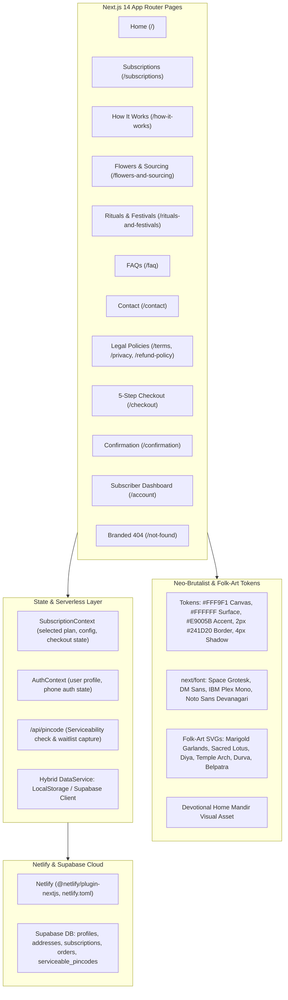

# Floro Devotional Flower Subscription Website — Production Implementation Plan (V2 - Refined)

> **For agentic workers:** REQUIRED SUB-SKILL: Use superpowers:subagent-driven-development to implement this plan task-by-task. Steps use checkbox (`- [ ]`) syntax for tracking.

**Goal:** Build an end-to-end, production-grade responsive website for Floro (daily devotional flower subscriptions) adhering strictly to `Floro_design.md`, ready for Netlify deployment with hybrid Local/Supabase persistence.

**Architecture:** Next.js 14 (App Router) + TypeScript + Tailwind CSS customized with exact tokens from `Floro_design.md` Section 5. Google Fonts (`Space Grotesk`, `DM Sans`, `IBM Plex Mono`, `Noto Sans Devanagari`) via `next/font/google`. Reusable neo-brutalist primitives with 2px borders, 4px hard offset shadows, handcrafted devotional folk-art SVGs, interactive PIN serviceability API, 3-tier catalog with configurable Premium option, 5-step checkout funnel with OTP and input persistence, subscriber account dashboard, legal policy pages, and Netlify adapter.

**Architecture Diagram:**

**Tech Stack:** Next.js 14.2+, React 18, TypeScript 5+, Tailwind CSS 3.4+, Lucide React, `@supabase/supabase-js`, `@netlify/plugin-nextjs`.

## Global Constraints
- Target platform: Responsive Web (Mobile 360px+, Tablet 600px-899px, Desktop 900px-1200px+).
- Design source of truth: `Floro_design.md` token system and neo-brutalist rules.
- Plan weights must strictly describe the **daily packet**, not the monthly total.
- Subscriptions are delivered daily, 365 days a year including Sundays and public holidays.
- Premium plan must offer explicit user selection: 2x Basic packets OR 1x Basic packet + 1x fresh Marigold Mala.
- PIN code serviceability must be validated before payment and accessible from home.
- Checkout must preserve inputs across step navigation and recoverable errors.
- Never use color alone for status; adhere to WCAG 2.2 AA.

---

### Task 1: Scaffolding, Next.js 14, Typography & Design Tokens Setup

**Files:**
- Create: `package.json`
- Create: `tsconfig.json`
- Create: `tailwind.config.ts`
- Create: `postcss.config.js`
- Create: `netlify.toml`
- Create: `.gitignore`
- Create: `.env.example`
- Create: `src/app/globals.css`
- Create: `src/app/layout.tsx`

**Interfaces:**
- Produces: Working Next.js project with Tailwind CSS tokens (`floro-canvas`, `floro-surface`, `floro-accent`, `floro-border`, `floro-marigold`, `floro-leaf`, `floro-terracotta`, `floro-indigo`, `shadow-neo`, `border-floro`), Google fonts via `next/font/google`, Netlify build configuration.

- [ ] **Step 1: Write package.json and install dependencies**
Dependencies: `next`, `react`, `react-dom`, `lucide-react`, `@supabase/supabase-js`. DevDeps: `typescript`, `@types/node`, `@types/react`, `@types/react-dom`, `tailwindcss`, `postcss`, `autoprefixer`, `@netlify/plugin-nextjs`.
- [ ] **Step 2: Configure tsconfig.json, postcss.config.js, tailwind.config.ts**
Configure strict TypeScript with `@/*` path alias. Configure Tailwind with complete tokens from `Floro_design.md` Section 5.
- [ ] **Step 3: Setup Google fonts and globals.css**
Import `Space_Grotesk`, `DM_Sans`, `IBM_Plex_Mono`, and `Noto_Sans_Devanagari` in `src/app/layout.tsx`. Set base canvas `#FFF9F1` and text `#20191C` in `src/app/globals.css`.
- [ ] **Step 4: Configure netlify.toml and .gitignore**
Set up `@netlify/plugin-nextjs`, build command `npm run build`, and publish directory `.next`.
- [ ] **Step 5: Run npm run build or verification command**
Verify clean compilation without errors.
- [ ] **Step 6: Commit Task 1**
`git add . && git commit -m "chore: scaffold Next.js app with Floro design tokens and Netlify config"`

---

### Task 2: Domain Types, Constants & Supabase Database Schema

**Files:**
- Create: `src/types/index.ts`
- Create: `src/lib/constants.ts`
- Create: `supabase/schema.sql`

**Interfaces:**
- Produces: Strict types for `PlanTier`, `PremiumOption`, `DeliveryAddress`, `Subscription`, `Order`, `ServiceablePincode`, `FaqItem`, `FlowerGlossaryItem`.
- Authoritative constant catalog: Value (₹450/mo, ~50g/day), Basic (₹600/mo, ~100g/day, Belpatra Mondays), Premium (₹900/mo, configurable), botanical flowers with Hindi script, initial tier 1/2 PIN codes, and trust pillars.

- [ ] **Step 1: Write src/types/index.ts**
Define interfaces for all data entities, form state, and checkout steps.
- [ ] **Step 2: Write src/lib/constants.ts**
Include exact plan data, inclusions/exclusions, flower glossary (गेंदा, गुड़हल, अपराजिता, चमेली, तुलसी, दूर्वा, बेलपत्र), sample serviceable PIN codes, and FAQs.
- [ ] **Step 3: Write supabase/schema.sql**
Write full DDL with RLS policies for `profiles`, `addresses`, `subscriptions`, `orders`, `serviceable_pincodes`, and `waitlist_leads`.
- [ ] **Step 4: Commit Task 2**
`git commit -m "feat(types): create domain interfaces, constant catalog, and Supabase SQL schema"`

---

### Task 3: Hybrid Storage Engine & PIN Code Serviceability API

**Files:**
- Create: `src/lib/supabase.ts`
- Create: `src/lib/storage.ts`
- Create: `src/app/api/pincode/route.ts`
- Create: `tests/storage.test.ts` (or node verification script)

**Interfaces:**
- Produces: `DataService` abstraction (`getPlans()`, `verifyPincode()`, `saveSubscription()`, `getSubscription()`, `saveOrder()`, `saveWaitlistLead()`), and `/api/pincode` GET/POST route.

- [ ] **Step 1: Implement src/lib/supabase.ts**
Instantiate typed Supabase client with fallback gracefully handled when env vars are missing.
- [ ] **Step 2: Implement src/lib/storage.ts**
Implement local storage simulation with seed data and Supabase remote sync when configured.
- [ ] **Step 3: Implement src/app/api/pincode/route.ts**
Validate 6-digit Indian PIN codes, check active delivery hubs, and handle waitlist submissions.
- [ ] **Step 4: Test storage and PIN code logic**
Run node execution test verifying PIN validation returns correct hub and unsupported codes trigger waitlist response.
- [ ] **Step 5: Commit Task 3**
`git commit -m "feat(api): implement hybrid storage service and PIN serviceability API route"`

---

### Task 4: Neo-Brutalist Component Primitives & Folk-Art SVG Elements

**Files:**
- Create: `src/components/common/NeoButton.tsx`
- Create: `src/components/common/NeoCard.tsx`
- Create: `src/components/common/NeoBadge.tsx`
- Create: `src/components/common/InputField.tsx`
- Create: `src/components/common/Accordion.tsx`
- Create: `src/components/folk-art/MarigoldBorder.tsx`
- Create: `src/components/folk-art/LotusIcon.tsx`
- Create: `src/components/folk-art/TempleArch.tsx`
- Create: `src/components/folk-art/GarlandDivider.tsx`
- Create: `src/components/folk-art/DiyaIcon.tsx`
- Create: `src/components/folk-art/SacredLeaves.tsx`

**Interfaces:**
- Produces: Accessible interactive primitives with 2px borders, 4px shadows, hover states, and original devotional vector artwork.

- [ ] **Step 1: Build NeoButton and NeoCard**
Support primary pink (`#E9005B`), secondary, and ghost variants with 48px touch targets and accessible focus rings.
- [ ] **Step 2: Build InputField, NeoBadge, and Accordion**
Accessible form inputs with top labels, error messages, and keyboard-operable accordion headers (`aria-expanded`).
- [ ] **Step 3: Build Folk-Art SVG Components**
Handcrafted vector SVGs for marigold blooms, sacred lotus, temple arches, diya flames, and bilva/tulsi leaves.
- [ ] **Step 4: Commit Task 4**
`git commit -m "feat(ui): add neo-brutalist primitives and devotional folk-art vector motifs"`

---

### Task 5: Global Layout, Header, Footer, Mobile Drawer & Contexts

**Files:**
- Create: `src/context/SubscriptionContext.tsx`
- Create: `src/context/AuthContext.tsx`
- Create: `src/components/layout/Header.tsx`
- Create: `src/components/layout/Footer.tsx`
- Create: `src/components/layout/MobileNav.tsx`
- Modify: `src/app/layout.tsx`

**Interfaces:**
- Produces: Sticky 76px header, responsive 64px mobile drawer, 3-column footer with policy links, shared subscription and authentication context.

- [ ] **Step 1: Implement SubscriptionContext and AuthContext**
Support plan selection, Premium configuration selection, checkout step persistence, and user phone session.
- [ ] **Step 2: Build Header component**
Desktop navigation with logo, nav links, Account link, and primary "Subscribe" button.
- [ ] **Step 3: Build MobileNav drawer**
Accessible modal drawer for small screens with keyboard trap and Esc-to-close.
- [ ] **Step 4: Build Footer component**
Links for subscriptions, how it works, sourcing, rituals, FAQ, contact, legal policies, and seasonal substitution disclaimer.
- [ ] **Step 5: Assemble in src/app/layout.tsx**
Wrap application in providers with font classes applied to `<body>`.
- [ ] **Step 6: Commit Task 5**
`git commit -m "feat(layout): implement header, footer, mobile navigation, and global contexts"`

---

### Task 6: Homepage (`/`) Implementation

**Files:**
- Copy: Hero image asset to `public/images/floro_hero_concept.jpg`
- Create: `src/components/home/HeroSection.tsx`
- Create: `src/components/home/TrustStrip.tsx`
- Create: `src/components/home/PincodeChecker.tsx`
- Create: `src/components/home/PlanPreviewSection.tsx`
- Create: `src/components/home/HowItWorksTeaser.tsx`
- Create: `src/components/home/FlowerCareSection.tsx`
- Create: `src/components/home/RitualStorySection.tsx`
- Create: `src/components/home/TestimonialsSection.tsx`
- Create: `src/components/home/FaqPreview.tsx`
- Create: `src/app/page.tsx`

**Interfaces:**
- Produces: High-converting homepage strictly matching Section 9.1 of `Floro_design.md`.

- [ ] **Step 1: Setup HeroSection with mandir artwork**
Headline: "Stay close to your traditions. Every morning.", primary CTA "Explore subscriptions", serviceability anchor, hero artwork.
- [ ] **Step 2: Setup TrustStrip & interactive PincodeChecker**
Substantiated claims: 365 days daily delivery, morning timing, transparent substitutions. Live PIN checker with instant status.
- [ ] **Step 3: Setup PlanPreviewSection**
Cards for Value, Basic, and Premium with daily weights, inclusions, and direct plan selection.
- [ ] **Step 4: Setup HowItWorksTeaser, FlowerCareSection, and RitualStorySection**
Storytelling on ritual significance and care standards.
- [ ] **Step 5: Assemble Homepage in src/app/page.tsx**
Integrate all sections, ensure responsive layout on mobile, tablet, desktop.
- [ ] **Step 6: Commit Task 6**
`git commit -m "feat(home): complete responsive homepage with hero, trust strip, PIN checker, and plans"`

---

### Task 7: Subscriptions Page (`/subscriptions`) & Plan Matrix

**Files:**
- Create: `src/components/subscriptions/PlanCard.tsx`
- Create: `src/components/subscriptions/PlanComparisonTable.tsx`
- Create: `src/components/subscriptions/PremiumConfigModal.tsx`
- Create: `src/app/subscriptions/page.tsx`

**Interfaces:**
- Produces: Dedicated comparison page with side-by-side cards, matrix table, and interactive Premium configurator (2 packets vs 1 packet + Mala).

- [ ] **Step 1: Build PlanCard with daily packet prominence**
Emphasize daily packet weight (50g / 100g), Monday Belpatra note, transparent exclusions, seasonal caveat.
- [ ] **Step 2: Build PremiumConfigModal**
Clear radio toggle between 2x Basic packets (200g daily) and 1x Basic packet + 1x fresh Marigold Mala daily.
- [ ] **Step 3: Build PlanComparisonTable**
Responsive matrix comparing all three plans across inclusions, weights, garland options, and pricing.
- [ ] **Step 4: Assemble Subscriptions page in src/app/subscriptions/page.tsx**
Include seasonal variation notice and link to checkout.
- [ ] **Step 5: Commit Task 7**
`git commit -m "feat(subscriptions): build comprehensive plan comparison and Premium configurator"`

---

### Task 8: Editorial & Information Pages & Legal Policies

**Files:**
- Create: `src/app/how-it-works/page.tsx`
- Create: `src/app/flowers-and-sourcing/page.tsx`
- Create: `src/app/rituals-and-festivals/page.tsx`
- Create: `src/app/faq/page.tsx`
- Create: `src/app/contact/page.tsx`
- Create: `src/app/terms/page.tsx`
- Create: `src/app/privacy/page.tsx`
- Create: `src/app/refund-policy/page.tsx`
- Create: `src/app/delivery-policy/page.tsx`

**Interfaces:**
- Produces: Complete educational, editorial, customer service, and legal policy pages.

- [ ] **Step 1: Build How It Works page**
Illustrated 5-step lifecycle: Plan choice -> OTP -> Address -> Morning delivery before puja -> Vacation pause.
- [ ] **Step 2: Build Flowers & Sourcing page**
Botanical flower glossary with Hindi script (गेंदा, गुड़हल, अपराजिता, चमेली, तुलसी, दूर्वा, बेलपत्र) and seasonal substitution standards.
- [ ] **Step 3: Build Rituals & Festivals page**
Cultural significance of offerings, deities, and upcoming Hindu festival calendar.
- [ ] **Step 4: Build FAQ and Contact pages**
Categorized search/filter FAQ accordion and working contact form.
- [ ] **Step 5: Build Legal Policy pages (Terms, Privacy, Refund, Delivery)**
Transparent policies on auto-renew, pauses, cancellations, and delivery standards.
- [ ] **Step 6: Commit Task 8**
`git commit -m "feat(pages): implement editorial, sourcing, festival, FAQ, contact, and legal policy pages"`

---

### Task 9: 5-Step Checkout Funnel & Confirmation Screen

**Files:**
- Create: `src/components/checkout/StepIndicator.tsx`
- Create: `src/components/checkout/DetailsStep.tsx`
- Create: `src/components/checkout/OtpStep.tsx`
- Create: `src/components/checkout/AddressStep.tsx`
- Create: `src/components/checkout/OrderReviewStep.tsx`
- Create: `src/components/checkout/PaymentStep.tsx`
- Create: `src/app/checkout/page.tsx`
- Create: `src/app/confirmation/page.tsx`

**Interfaces:**
- Produces: 5-step guided checkout funnel with phone OTP verification, live PIN serviceability check, order review, payment simulation, and authoritative confirmation screen.

- [ ] **Step 1: Build StepIndicator and state machine container**
Steps: Details (1) -> OTP (2) -> Address (3) -> Review (4) -> Payment (5). Preserves entered state on back button.
- [ ] **Step 2: Implement DetailsStep and OtpStep**
Name, phone, email inputs; 4-digit OTP supporting test code `1234`, paste, resend timer (30s).
- [ ] **Step 3: Implement AddressStep with PIN verification**
Address fields with live PIN code check before allowing next step.
- [ ] **Step 4: Implement OrderReviewStep & PaymentStep**
Daily weight summary, monthly total, start date (tomorrow morning), seasonal substitution note, simulated payment methods (UPI, Card, NetBanking).
- [ ] **Step 5: Implement Confirmation page (`/confirmation`)**
Order reference `FLR-XXXXXX`, plan details, delivery time (5:30 AM - 7:30 AM), and link to My Account.
- [ ] **Step 6: Commit Task 9**
`git commit -m "feat(checkout): implement 5-step checkout flow with OTP and order confirmation"`

---

### Task 10: Subscriber Dashboard, 404 Page, Build Verification & Netlify Readiness

**Files:**
- Create: `src/components/account/SubscriptionSummary.tsx`
- Create: `src/components/account/DeliveryCalendar.tsx`
- Create: `src/components/account/ManageSubscriptionModal.tsx`
- Create: `src/app/account/page.tsx`
- Create: `src/app/not-found.tsx`
- Create: `README.md`

**Interfaces:**
- Produces: Working subscriber dashboard with active plan view, pause/skip/cancel controls, branded 404 page, verified production build.

- [ ] **Step 1: Implement Subscriber Dashboard (`/account`)**
View active subscription, delivery schedule, address management, and modal controls for pause/skip/cancel.
- [ ] **Step 2: Implement Branded 404 Page (`/not-found.tsx`)**
Respectful neo-brutalist 404 page with return to home and subscriptions links.
- [ ] **Step 3: Write README.md**
Detailed instructions on architecture, local development, Supabase connection, and Netlify deployment.
- [ ] **Step 4: Execute production build**
Run: `npm run build` and ensure 100% clean compilation, zero TypeScript errors, zero missing routes.
- [ ] **Step 5: Commit Task 10 and finalize**
`git commit -m "feat(account): add subscriber dashboard, 404 page, and complete production build verification"`
