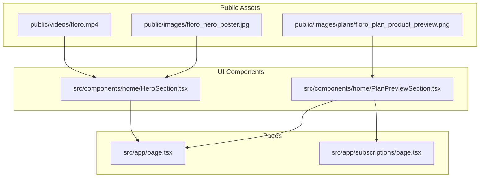

# Hero Looping Video & Plan Card Product Previews Implementation Plan

> **For agentic workers:** REQUIRED SUB-SKILL: Use superpowers:subagent-driven-development to implement this plan task-by-task. Steps use checkbox (`- [ ]`) syntax for tracking.

**Goal:** Integrate a seamless looping video (`floro.mp4`) in the Hero section and add a high-quality product package preview (`Gemini_Generated_Image_hh0f0chh0f0chh0f.png`) as a top banner on all subscription plan cards.

**Architecture:** Web-optimized video and image assets are staged in `public/videos/` and `public/images/plans/`. `HeroSection.tsx` replaces its static `<Image>` with an auto-playing, muted, looping, plays-inline `<video>` tag with a poster fallback. `PlanPreviewSection.tsx` renders a responsive, neo-brutalist product preview banner at the top of each plan card before the title and pricing.

**Architecture Diagram:**

**Tech Stack:** Next.js 14 (App Router), TypeScript, Tailwind CSS, ffmpeg for media optimization.

## Global Constraints
- Video MUST be muted, autoplay, loop, and playsInline for universal browser auto-playback without user gesture.
- All media files MUST be placed in `public/` and reference root-relative URLs.
- Neo-Brutalist visual language (2px border `#241D20`, rounded borders, shadows, hover zoom) MUST be preserved.
- Zero TypeScript type errors (`npx tsc --noEmit`).

---

### Task 1: Stage and Optimize Media Assets

**Files:**
- Create: `public/videos/floro.mp4`
- Create: `public/images/floro_hero_poster.jpg`
- Create: `public/images/plans/floro_plan_product_preview.png`

**Interfaces:**
- Produces: `/videos/floro.mp4`, `/images/floro_hero_poster.jpg`, `/images/plans/floro_plan_product_preview.png`

- [ ] **Step 1: Create directories if not existing**
- [ ] **Step 2: Optimize `floro.mp4` into `public/videos/floro.mp4` using ffmpeg (H.264, faststart, muted, web-streamable)**
- [ ] **Step 3: Extract first frame poster to `public/images/floro_hero_poster.jpg`**
- [ ] **Step 4: Optimize and copy `Gemini_Generated_Image_hh0f0chh0f0chh0f.png` to `public/images/plans/floro_plan_product_preview.png`**
- [ ] **Step 5: Verify files exist and sizes are appropriate**

---

### Task 2: Implement Looping Video in HeroSection

**Files:**
- Modify: `src/components/home/HeroSection.tsx`

**Interfaces:**
- Consumes: `/videos/floro.mp4`, `/images/floro_hero_poster.jpg`

- [ ] **Step 1: Replace static `<Image>` in `HeroSection.tsx` with `<video>` element**
  - Attributes: `autoPlay`, `loop`, `muted`, `playsInline`, `poster="/images/floro_hero_poster.jpg"`, `preload="auto"`
  - Classes: `w-full h-auto aspect-[16/9] object-cover`
- [ ] **Step 2: Maintain existing card border, shadow, and floating pill status (`Daily Morning Puja Packet` + `Fresh`)**
- [ ] **Step 3: Verify TypeScript compilation**

---

### Task 3: Add Product Preview Banner to Plan Cards

**Files:**
- Modify: `src/components/home/PlanPreviewSection.tsx`

**Interfaces:**
- Consumes: `/images/plans/floro_plan_product_preview.png`

- [ ] **Step 1: Add top preview banner above plan title in `PlanPreviewSection.tsx`**
  - Container: `aspect-[16/10] w-full mb-5 rounded-control overflow-hidden border-2 border-floro-border bg-floro-canvas relative`
  - Next.js `<Image>` with `fill`, `object-cover`, hover zoom transition
  - Include small daily weight chip in lower left of preview
- [ ] **Step 2: Ensure symmetrical alignment across Value, Basic, and Premium cards**
- [ ] **Step 3: Verify TypeScript compilation**

---

### Task 4: Visual & Interactive Verification

**Files:**
- Verify: `http://localhost:3000` (Homepage)
- Verify: `http://localhost:3000/subscriptions` (Subscriptions page)

- [ ] **Step 1: Start dev server (`npm run dev`) if not running**
- [ ] **Step 2: Open and capture hero video playback via browser/cua-driver to confirm looping behavior**
- [ ] **Step 3: Verify plan cards visual layout on desktop and mobile viewports**
- [ ] **Step 4: Run full verification suite (`npx tsc --noEmit`)**
