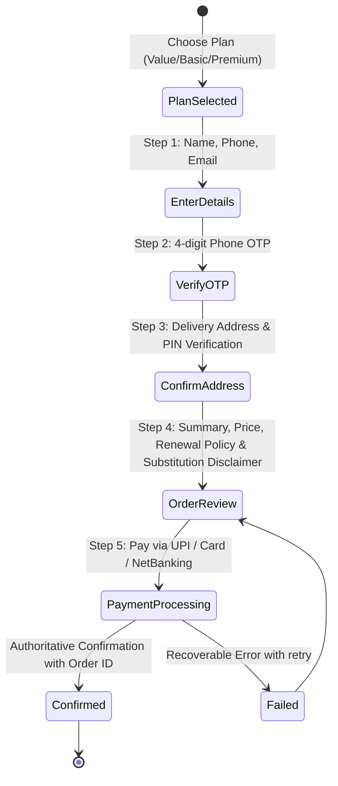

# Technical Design Specification: Floro Devotional Flower Subscription Website

> **Date:** 2026-10-10  
> **Status:** Draft / Ready for User Review  
> **Target Platform:** Responsive Web (Next.js 14 App Router, TypeScript, Tailwind CSS)  
> **Hosting & Infrastructure:** Netlify (with `@netlify/plugin-nextjs`)  
> **Data & Backend:** Hybrid state layer (Local/Mock state engine + Supabase PostgreSQL schema & client)  
> **Design Foundation:** `Floro_design.md` (Neo-brutalist structure + Indian folk-art devotional storytelling)

---

## 1. System Architecture & Tech Stack

### 1.1 Core Stack
- **Framework:** Next.js 14+ (App Router, Server Components + targeted Client Components)
- **Language:** TypeScript (Strict mode enabled)
- **Styling:** Tailwind CSS with centralized design tokens matching `Floro_design.md` Section 5
- **Icons:** `lucide-react` for crisp neo-brutalist functional icons
- **Visual Assets:** Handcrafted responsive SVGs for devotional folk-art motifs (Marigold garlands, Lotus petals, Diya/Kalas, Temple architecture borders) + generated high-res hero visual asset
- **State Management:**
  - `SubscriptionContext` / `CheckoutContext` for persistent client-side multi-step state
  - Modular `DataService` interface: defaults to client-side localStorage simulation, seamlessly toggles to `@supabase/supabase-js` when credentials are supplied
- **Deployment:** Netlify with `@netlify/plugin-nextjs` and `netlify.toml` routing configuration

### 1.2 File & Directory Structure
```
redisigning floro/
├── .env.example
├── .gitignore
├── netlify.toml
├── package.json
├── postcss.config.js
├── tailwind.config.ts
├── tsconfig.json
├── docs/
│   └── superpowers/
│       └── specs/
│           └── 2026-10-10-floro-website-design.md
├── supabase/
│   └── schema.sql
├── public/
│   ├── images/
│   │   └── floro_hero_concept.jpg
│   └── favicon.ico
└── src/
    ├── app/
    │   ├── layout.tsx
    │   ├── page.tsx                          # Home page
    │   ├── subscriptions/
    │   │   └── page.tsx                      # Dedicated plan comparison
    │   ├── how-it-works/
    │   │   └── page.tsx                      # Step-by-step subscription lifecycle
    │   ├── flowers-and-sourcing/
    │   │   └── page.tsx                      # Botanical glossary & seasonal substitutions
    │   ├── rituals-and-festivals/
    │   │   └── page.tsx                      # Devotional editorial & calendar
    │   ├── faq/
    │   │   └── page.tsx                      # Searchable/categorized FAQ accordion
    │   ├── contact/
    │   │   └── page.tsx                      # Verified support & customer channels
    │   ├── checkout/
    │   │   └── page.tsx                      # Multi-step checkout funnel
    │   ├── confirmation/
    │   │   └── page.tsx                      # Order success & next delivery steps
    │   ├── account/
    │   │   └── page.tsx                      # Subscriber dashboard & management
    │   └── not-found.tsx                     # Branded 404 page
    ├── components/
    │   ├── layout/
    │   │   ├── Header.tsx
    │   │   ├── Footer.tsx
    │   │   └── MobileNav.tsx
    │   ├── common/
    │   │   ├── NeoButton.tsx
    │   │   ├── NeoCard.tsx
    │   │   ├── NeoBadge.tsx
    │   │   ├── InputField.tsx
    │   │   └── Accordion.tsx
    │   ├── folk-art/
    │   │   ├── MarigoldBorder.tsx
    │   │   ├── LotusIcon.tsx
    │   │   ├── TempleArch.tsx
    │   │   └── GarlandDivider.tsx
    │   ├── subscriptions/
    │   │   ├── PlanCard.tsx
    │   │   ├── PlanComparisonTable.tsx
    │   │   └── PremiumConfigModal.tsx
    │   ├── checkout/
    │   │   ├── StepIndicator.tsx
    │   │   ├── DetailsStep.tsx
    │   │   ├── OtpStep.tsx
    │   │   ├── AddressStep.tsx
    │   │   ├── OrderReviewStep.tsx
    │   │   └── PaymentMockStep.tsx
    │   ├── home/
    │   │   ├── HeroSection.tsx
    │   │   ├── TrustStrip.tsx
    │   │   ├── PincodeChecker.tsx
    │   │   ├── FlowerCareSection.tsx
    │   │   └── EditorialPreview.tsx
    │   └── account/
    │       ├── SubscriptionSummary.tsx
    │       ├── DeliveryCalendar.tsx
    │       └── ManagePlanActions.tsx
    ├── context/
    │   ├── SubscriptionContext.tsx
    │   └── AuthContext.tsx
    ├── lib/
    │   ├── constants.ts                      # Pricing, plan tiers, mock PINs, FAQ data
    │   ├── supabase.ts                       # Supabase client instantiation
    │   └── storage.ts                        # Storage repository with Supabase/Local fallback
    └── types/
        └── index.ts                          # Full TypeScript interfaces
```

---

## 2. Design Tokens & Visual Language

Directly mapped to Section 5 of `Floro_design.md`:

### 2.1 Color Palette
- **Canvas (Background):** `#FFF9F1` (Warm Ivory)
- **Surface (Cards & Modals):** `#FFFFFF` (Pure White)
- **Surface Soft:** `#F4EEE6`
- **Surface Muted:** `#EFE7DD`
- **Text Primary:** `#20191C` (Near Black)
- **Text Secondary:** `#63595C`
- **Text Muted:** `#807579`
- **Brand Accent:** `#E9005B` (Floro Pink — high-contrast conversion CTA fill)
- **Brand Accent Hover:** `#C9004E`
- **Brand Accent Soft:** `#FFE4EE`
- **Borders:** `#241D20` (2px solid standard border)
- **Subtle Borders:** `#D8CDC7` (1px divider)
- **Folk Accents:**
  - Marigold Yellow: `#F2B72F`
  - Leaf Green: `#758B32`
  - Terracotta: `#B84E36`
  - Indigo: `#2E4D86`
- **Functional Semantics:**
  - Success: `#286342` (Bg: `#E7F3EA`)
  - Warning: `#8A5200` (Bg: `#FFF1D6`)
  - Error: `#B4233D` (Bg: `#FCE8EC`)
  - Information: `#2459A6` (Bg: `#E8F0FC`)

### 2.2 Neo-Brutalist Layout System
- **Borders:** `2px solid #241D20` on all cards, buttons, badges, and active inputs.
- **Shadows:** Hard offset `4px 4px 0 #241D20`.
- **Hover Motion:** Controls translate `-2px, -2px` with shadow expanding to `6px 6px 0 #241D20`. Active click shifts `+2px, +2px` with shadow shrinking to `2px 2px 0 #241D20`.
- **Corner Radii:** Square-to-soft (`rounded-lg` 8px for controls, `rounded-xl` 10px–14px for cards, `rounded-full` for status pills).
- **Typography:**
  - Headings: `Space Grotesk`, sans-serif (700/600 weight, tight letter spacing `-0.03em`)
  - Body & UI: `DM Sans`, sans-serif (400 regular, 500 medium, 700 bold)
  - Numerals & Codes: Tabular figures enabled (`tabular-nums`)
  - Hindi Script: `Noto Sans Devanagari` fallback for flower names (गेंदा, कमल, गुड़हल, अपराजिता, तुलसी, दूर्वा, बेलपत्र)

---

## 3. Product Catalog & Subscription Rules

Explicitly grounded in the plan specifications:

### 3.1 Plan Tiers
1. **Value Plan**
   - **Price:** ₹450 / month
   - **Daily Packet Weight:** Approx. 50 g (Daily delivery, 30 days/month including Sundays and public holidays)
   - **Inclusions:** Fresh marigold petals & heads, hibiscus, butterfly pea / aparajita, doobh (durva) grass, holy basil (tulsi).
   - **Exclusions:** Garlands (mala) not included.
   - **Substitutions:** Seasonal availability notice explicitly shown.

2. **Basic Plan**
   - **Price:** ₹600 / month
   - **Daily Packet Weight:** Approx. 100 g (Daily delivery, 30 days/month including Sundays and public holidays)
   - **Inclusions:** Daily mix flower pack with Marigold, Doobh Grass, Basil, Hibiscus, Butterfly Pea, Jasmine/Shevanti, and Belpatra on Mondays.
   - **Exclusions:** Daily garland not included.

3. **Premium Plan**
   - **Price:** ₹900 / month
   - **Daily Packet Weight / Composition:** Explicit user selection between:
     - **Option A:** Two 100 g Basic flower packets daily (200 g total daily).
     - **Option B:** One 100 g Basic packet daily + One hand-strung fresh Marigold Mala (garland) daily.
   - **UI Requirement:** Selection modal/radio toggle on card with plain explanation before adding to checkout.

### 3.2 Serviceability Logic
- PIN Code checker on Homepage and Checkout.
- Supported initial sample tier 1/2 hubs: Delhi NCR (`110001` - `110096`), Bengaluru (`560001` - `560100`), Mumbai (`400001` - `400099`), Pune (`411001` - `411050`), Hyderabad (`500001` - `500090`), Chennai (`600001` - `600090`), Kolkata (`700001` - `700090`), Varanasi (`221001` - `221010`), Jaipur (`302001` - `302030`), Ahmedabad (`380001` - `380060`).
- Validates 6-digit Indian PIN codes; provides instant feedback for serviceable areas and friendly waitlist notification for unsupported areas.

---

## 4. Multi-Step Checkout State Machine

The checkout funnel follows the strict sequence demanded by `Floro_design.md`:



### 4.1 State Rules:
- Inputs are preserved if user goes back to a prior step.
- OTP supports auto-fill, test code `1234`, paste, resend cooldown (30s), and error messaging.
- Order Review displays daily packet weights, monthly charge, delivery commencement date (tomorrow morning between 5:30 AM - 7:30 AM), and seasonal policy.
- Payment step offers mock UPI (GPay, PhonePe, Paytm), Cards, and NetBanking, producing a verifiable order record with reference `FLR-XXXXXX`.

---

## 5. Supabase Schema & Data Model

When connecting to Supabase, the following tables support the entire service lifecycle:

```sql
-- 1. Profiles (User details)
CREATE TABLE IF NOT EXISTS profiles (
  id UUID PRIMARY KEY DEFAULT gen_random_uuid(),
  phone VARCHAR(15) UNIQUE NOT NULL,
  full_name VARCHAR(100) NOT NULL,
  email VARCHAR(150),
  created_at TIMESTAMPTZ DEFAULT NOW()
);

-- 2. Delivery Addresses
CREATE TABLE IF NOT EXISTS addresses (
  id UUID PRIMARY KEY DEFAULT gen_random_uuid(),
  profile_id UUID REFERENCES profiles(id) ON DELETE CASCADE,
  address_line1 TEXT NOT NULL,
  address_line2 TEXT,
  landmark TEXT,
  pincode VARCHAR(6) NOT NULL,
  city VARCHAR(50) NOT NULL,
  state VARCHAR(50) NOT NULL,
  is_default BOOLEAN DEFAULT TRUE,
  created_at TIMESTAMPTZ DEFAULT NOW()
);

-- 3. Subscriptions
CREATE TABLE IF NOT EXISTS subscriptions (
  id UUID PRIMARY KEY DEFAULT gen_random_uuid(),
  profile_id UUID REFERENCES profiles(id) ON DELETE CASCADE,
  plan_tier VARCHAR(20) NOT NULL CHECK (plan_tier IN ('value', 'basic', 'premium')),
  premium_config VARCHAR(50) CHECK (premium_config IN ('two_packets', 'packet_with_mala', null)),
  monthly_price NUMERIC(10, 2) NOT NULL,
  status VARCHAR(20) DEFAULT 'active' CHECK (status IN ('active', 'paused', 'cancelled')),
  address_id UUID REFERENCES addresses(id),
  start_date DATE NOT NULL,
  next_delivery_time VARCHAR(50) DEFAULT '5:30 AM - 7:30 AM',
  created_at TIMESTAMPTZ DEFAULT NOW()
);

-- 4. Orders / Transactions
CREATE TABLE IF NOT EXISTS orders (
  id UUID PRIMARY KEY DEFAULT gen_random_uuid(),
  order_reference VARCHAR(50) UNIQUE NOT NULL,
  profile_id UUID REFERENCES profiles(id) ON DELETE CASCADE,
  subscription_id UUID REFERENCES subscriptions(id),
  amount NUMERIC(10, 2) NOT NULL,
  payment_status VARCHAR(20) DEFAULT 'paid' CHECK (payment_status IN ('pending', 'paid', 'failed')),
  payment_method VARCHAR(50) NOT NULL,
  created_at TIMESTAMPTZ DEFAULT NOW()
);

-- 5. Serviceable PIN Codes
CREATE TABLE IF NOT EXISTS serviceable_pincodes (
  pincode VARCHAR(6) PRIMARY KEY,
  city VARCHAR(50) NOT NULL,
  state VARCHAR(50) NOT NULL,
  hub_name VARCHAR(100),
  is_active BOOLEAN DEFAULT TRUE
);
```

---

## 6. Netlify Hosting Configuration

A `netlify.toml` file at project root handles the Next.js runtime build:
```toml
[build]
  command = "npm run build"
  publish = ".next"

[[plugins]]
  package = "@netlify/plugin-nextjs"

[build.environment]
  NODE_VERSION = "20"
```

---

## 7. Acceptance Criteria & Guardrails

- [x] Full token fidelity: Neo-brutalist styling, 2px borders `#241D20`, `#FFF9F1` canvas, `#E9005B` pink CTA accent.
- [x] Unambiguous subscription pricing: Weights described as daily packets, prices shown per month, Sundays/holidays included.
- [x] Premium plan explicit configuration choice: Two packets vs. One packet + Mala.
- [x] Clear seasonal substitution notice displayed across plans, sourcing page, and checkout review.
- [x] Interactive PIN code serviceability verification.
- [x] Accessible 5-step checkout flow with OTP and confirmation.
- [x] Authenticated subscriber account dashboard.
- [x] Production ready for Netlify and Supabase.
